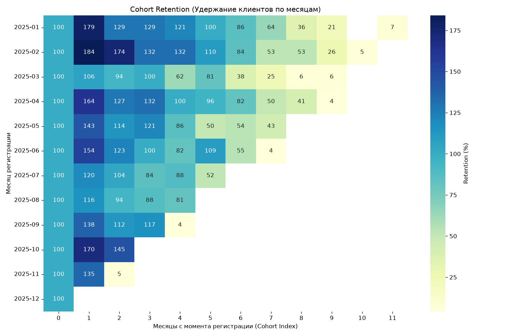

# Customer RFM & Cohort Analysis

Учебно-портфолио проект: сегментация клиентов по методике RFM и когортный анализ удержания (Retention) для оценки эффективности маркетинга.

## Бизнес-задача
Для удержания клиентов и оптимизации рекламного бюджета необходимо понимать, насколько ценны разные группы клиентов и как долго они остаются с компанией. Проект решает две задачи:
1. **RFM-сегментация**: деление клиентов на группы (VIP, Loyal, At Risk, Lost) на основе давности покупки (Recency), частоты (Frequency) и суммы (Monetary).
2. **Когортный анализ**: оценка того, какой процент клиентов возвращается в банк спустя 1, 2, 3 и более месяцев после регистрации.

## Стек
- **PostgreSQL 16** (в проде — GreenPlum)
- **Python 3.14**: pandas, numpy, sqlalchemy, matplotlib, seaborn
- **Docker**, Git

## Быстрый старт

1. Поднять базу данных:
   ```bash
   docker compose up -d
2. Применить схему БД (локальный psql не требуется):
Для Windows (PowerShell):
   ```powershell
   Get-Content sql/01_schema.sql -Raw | docker compose exec -T db psql -U postgres -d rfm_db
Для macOS / Linux:
   ```bash
   docker compose exec -T db psql -U postgres -d rfm_db < sql/01_schema.sql
   ```
3. Сгенерировать данные и запустить пайплайн:
   ```bash
   python data/generate_data.py
   python scripts/load_to_db.py
   python run.py

## Пример работы (визуализация)
Тепловая карта удержания клиентов (Cohort Retention). Чем темнее цвет, тем выше процент вернувшихся клиентов:


## Что демонстрирует проект
- SQL (Оконные функции): использование NTILE(5) для деления клиентов на квантили (расчет RFM-оценок) в 02_rfm.sql.
- pandas: сводные таблицы (pivot), работа с датами (to_period), вычисление метрик удержания.
- Визуализация: построение heatmap с помощью библиотеки seaborn.
- Git-flow: воспроизводимый пайплайн от генерации «грязных» данных до бизнес-отчета.